# Лабораторная работа №4: Автоматизация развертывания с помощью Ansible

## Ход выполнения работы

### 1. Создание пользователя runner
Создание пользователя `runner` на `managed-node` и добавление его в группу `sudo`.

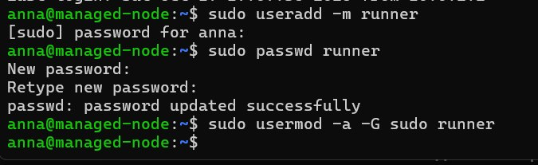

### 2. Проверка доступности по SSH
Успешное подключение по SSH к узлу `runner@10.0.2.16`.

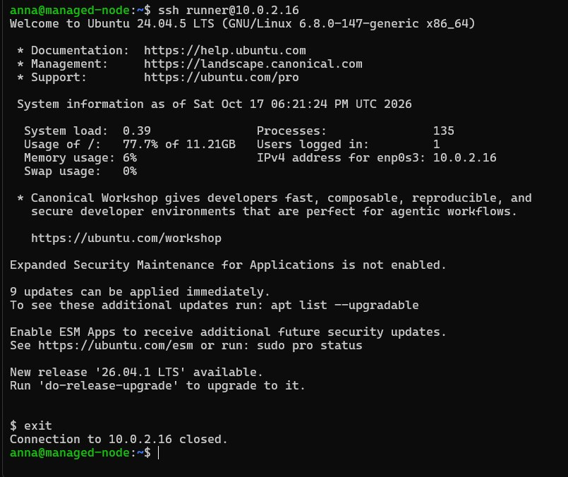

### 3. Проверка связности через Ansible
Выполнение `ansible -i inventory webservers -m ping` (получен ответ `pong`).

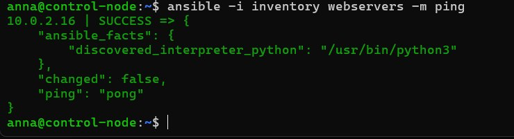

### 4. Настройка NOPASSWD в sudoers
Добавление строки `runner ALL=(ALL) NOPASSWD:ALL` в `/etc/sudoers`.

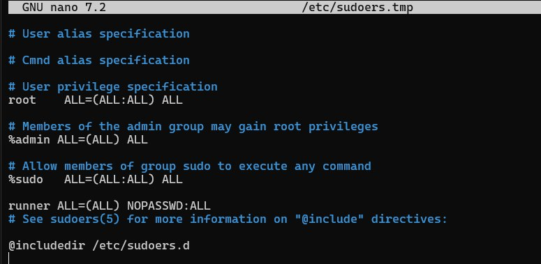

### 5. Создание структуры проекта
Создание директории `lab-ansible` и файлов `playbook.yml` и `inventory.ini`.

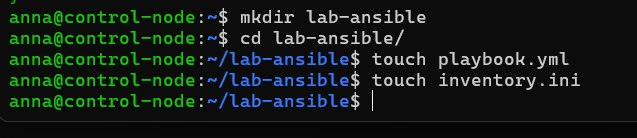

### 6. Настройка инвентарного файла
Заполнение `inventory.ini` с группой `[webservers]` и IP-адресом `10.0.2.16`.

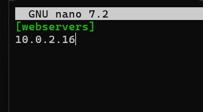

### 7. Написание плейбука для Nginx
Создание `playbook.yml` с задачей установки Nginx через модуль `apt`.

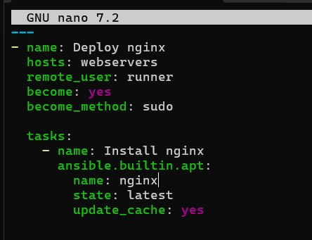

### 8. Проверка плейбука (--check)
Запуск плейбука в режиме тестирования с флагом `--check`.

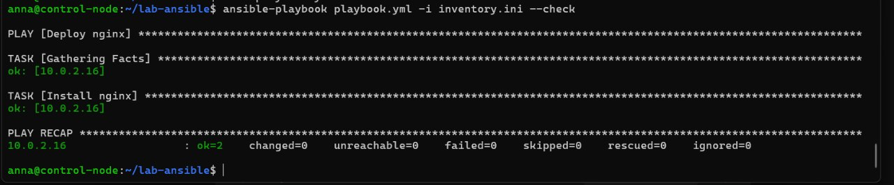

### 9. Запуск плейбука
Выполнение плейбука и установка Nginx на управляемый узел.

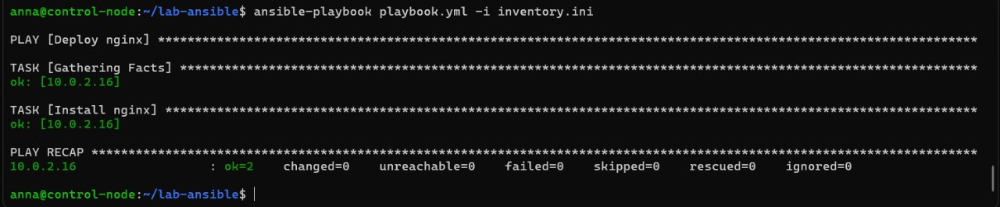

### 10. Создание HTML-страницы
Создание файла `index.html` с текстом `Hello from Ansible playbook!`.

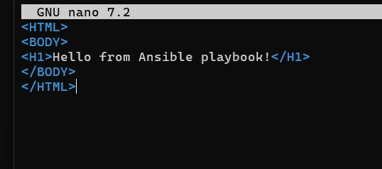

### 11. Обновление плейбука
Добавление в `playbook.yml` задачи копирования `index.html` через модуль `copy`.

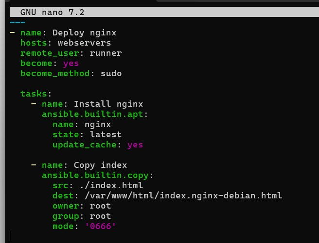

### 12. Финальный запуск плейбука
Повторный запуск плейбука и успешная передача файла HTML (`changed=1`).

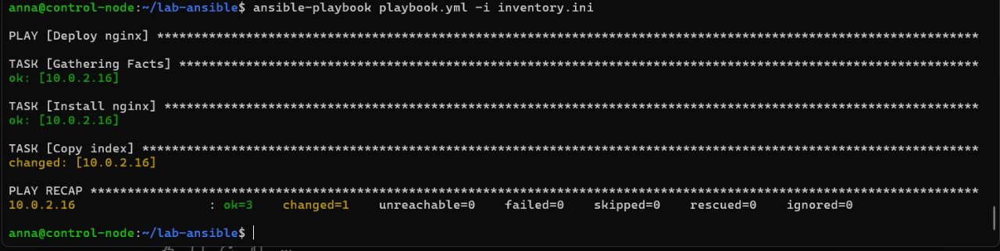

### 13. Проверка работы через curl
Проверка ответа веб-сервера командой `curl http://10.0.2.16`.

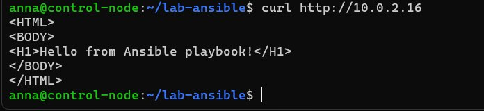

### 14. Проверка в браузере
Проверка отображения страницы в браузере по адресу `localhost:8081`.

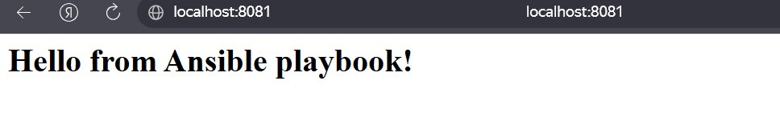
